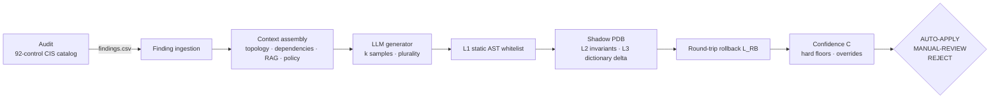

# ORACLE-REMEDIATE

**Context-aware, safety-verified LLM remediation for CIS Benchmark compliance on Oracle
Multitenant (CDB/PDB) databases, including RAC and Exadata.**

[](https://github.com/devendraprajput-cloud/oracle-remediate/actions/workflows/ci.yml)
[](LICENSE)

Reference implementation of the ORACLE-REMEDIATE framework (Rajput, Dantuluri, Bajaj,
Kolhe). For each CIS Oracle Database 19c finding it:

1. assembles **context** -- live topology (RAC, PDBs, Data Guard, Exadata cells),
   application dependencies, retrieved documentation (Oracle 23ai AI Vector Search) and
   organisation policy;
2. asks an **LLM** for a remediation *and* a matched rollback, k times, and takes the
   plurality answer;
3. runs a **three-layer safety verifier** -- static AST whitelist, semantic invariants
   with a non-interference sample, and execution in a **shadow PDB** with a
   data-dictionary delta check -- plus a **round-trip rollback** test;
4. combines agreement, verifier strength, rollback outcome and self-reported risk into a
   **confidence score** and maps it to **AUTO-APPLY / MANUAL-REVIEW / REJECT**, with hard
   floors and review-only overrides.

> **Status: research prototype.** Production execution is disabled by default and needs
> both `apply.enabled: true` and `--apply`. Run it against disposable test databases
> first. Read [docs/DESIGN_NOTES.md](docs/DESIGN_NOTES.md) before reporting results.

---

## Architecture



The full sequence (paper Fig. 1) with module names is in
[docs/ARCHITECTURE.md](docs/ARCHITECTURE.md); the section-by-section mapping is in
[docs/PAPER_TRACEABILITY.md](docs/PAPER_TRACEABILITY.md).

```
C = 0.40·A + 0.30·V + 0.20·L_RB + 0.10·R          V = (L1 + L2 + L3) / 3
AUTO-APPLY if C >= 0.85 · MANUAL-REVIEW if 0.55 <= C < 0.85 · REJECT otherwise
Hard floor: L3 = 0 or L_RB = 0  ->  REJECT
```

## Repository layout

```
src/oracle_remediate/
  ingestion/      finding normalisation (CSV, JSONL, column mappings)
  audit/          audit phase: run catalog invariants per container
  context/        topology + dependency sources, context assembler (4 classes)
  rag/            embedders, in-memory and Oracle 23ai vector stores, retriever
  llm/            prompt builder, Anthropic/OpenAI/OpenAI-compatible/LangChain backends,
                  self-consistency generator, deterministic mock backend
  verify/         Oracle lexer/classifier, Layer 1, snapshots/deltas, sandbox API,
                  Layer 2/3 + round-trip verifier, .ora file editor
  db/             python-oracledb client, shadow-PDB and CDB sandboxes
  scoring/        confidence score, decision policy, policy-context file
  sim/            offline Oracle dictionary simulator + seeded benchmark scenario
  eval/           Pass@k, safety, rollback fidelity, kappa, CI, calibration, ablation
  pipeline.py     per-finding orchestration and artefact writer
  apply.py        guarded production apply (off by default)
  cli.py          `orarem` command
controls/catalog.yaml       control catalog: typed invariants phi_c (73 of 92 controls)
config/                     defaults, snapshot views, example policy
prompts/                    system and user prompt templates
knowledge/                  original notes for the documentation context
benchmark/                  seed SQL, topology profiles, reproduction guide
docker/                     app image, benchmark compose stack
tests/                      unit, pipeline and (opt-in) live-Oracle tests
docs/                       architecture, traceability, design notes, catalog guide
```

## Quick start (offline, no Oracle or API key needed)

```bash
python -m venv .venv && source .venv/bin/activate
pip install -e ".[dev]"
pytest                                            # 62 tests; 2 live-Oracle tests skip
orarem --config config/default.yaml demo          # audit + remediate on the simulator
orarem --config config/default.yaml demo --topology exadata --eval --out runs/eval
orarem eval report runs/eval/run-*                # Pass@k, safety, rollback fidelity
```

`demo` uses the **simulator** and the **mock backend**. They exercise every code path
(including the paper's control 4.7 example, rejected by the rollback hard floor), but
their numbers are not LLM results.

## Running against Oracle

1. **Database users** (test CDB first): see `benchmark/seed/00_audit_user.sql` --
   a read-only audit user (`SELECT_CATALOG_ROLE`, `SET CONTAINER`) and a sandbox
   administrator (`CREATE PLUGGABLE DATABASE`).
2. **Environment variables** (names are configurable; secrets are never in YAML):
   ```bash
   export ORAREM_TARGET_DSN=dbhost:1521/ORCLCDB ORAREM_AUDIT_USER=c##orarem_audit ORAREM_AUDIT_PASSWORD=...
   export ORAREM_SANDBOX_ADMIN_DSN=dbhost:1521/ORCLCDB ORAREM_SANDBOX_ADMIN_USER=c##orarem_sandbox ORAREM_SANDBOX_ADMIN_PASSWORD=...
   export ANTHROPIC_API_KEY=...        # or OPENAI_API_KEY, or a local Llama endpoint
   ```
3. **Local config** `config/local.yaml` (git-ignored):
   ```yaml
   sandbox: {mode: oracle, exadata: auto}
   llm: {backend: anthropic, model: claude-opus-4-7}
   files: {sqlnet_ora: /u01/app/oracle/product/19.0.0/dbhome_1/network/admin/sqlnet.ora,
           listener_ora: /u01/app/oracle/product/19.0.0/dbhome_1/network/admin/listener.ora}
   ```
4. **Validate the SQL on your release**, then audit and remediate:
   ```bash
   ORAREM_TEST_DSN=... ORAREM_TEST_USER=... ORAREM_TEST_PASSWORD=... pytest -m oracle
   orarem --config config/default.yaml --config config/local.yaml audit --out findings.csv
   orarem --config config/default.yaml --config config/local.yaml remediate --findings findings.csv
   ```
   Each finding gets `remediation.sql`, `rollback.sql`, `verification.sql`,
   `decision.json` and `rationale.md` under `runs/run-<timestamp>/findings/`.
5. **Shadow PDB clone** -- `sandbox.clone_sql` is a template. On Exadata it uses
   `SNAPSHOT COPY`; elsewhere a full clone (add `FILE_NAME_CONVERT` without OMF).
   CDB-level parameters and common grants need `sandbox.cdb_sandbox` (a disposable CDB);
   without it they are rejected with an explicit reason rather than passed.
6. **Documentation context** -- the shipped `knowledge/` notes are a starting point.
   Ingest your licensed CIS / Security Guide / MOS material:
   `orarem --config ... rag ingest /path/to/licensed_docs` (set `rag.store: oracle23ai`
   for AI Vector Search).

The Bash + SQL*Plus audit route is `audit/run_audit.sh`.

## LLM backends

| Paper backend | `llm.backend` | Example `llm.model` | Temperature 0.3 |
|---|---|---|---|
| Claude Opus 4.7 | `anthropic` | `claude-opus-4-7` | **not accepted** (Anthropic documents HTTP 400 for non-default sampling parameters on Opus 4.7 and later) |
| GPT-5-class | `openai` | `gpt-5` | **not accepted** (GPT-5 reasoning models accept only the default) |
| Llama-3.3-70B | `openai_compatible` | `meta-llama/Llama-3.3-70B-Instruct` (vLLM) | applied |
| any LangChain chat model | `langchain` | provider-specific | as supported |

`temperature_policy: auto` handles this and records `temperature_applied` per run;
see D3 in the design notes. Provider rules change -- check the current documentation.

## Evaluation (paper Section IV)

```bash
orarem ... remediate --findings findings.csv --eval --out runs/opus47-1   # repeat x5
orarem eval report runs/opus47-*/run-*          # RQ1 Pass@1/3/5 (+95% CI), RQ2 safety, RQ4 rollback
orarem eval report RUN --labels labels.csv      # RQ2 false-negative rate from DBA labels
orarem ... eval ablation --findings findings.csv  # RQ3 per-context-class ablation + zero-shot
orarem eval calibrate RUN... --correct held_out.csv   # tau_auto / tau_review (III.D-3)
```

Run summaries include tokens, wall-clock time and (with `llm.price_per_mtok`) USD cost.

## Configuration highlights

| Key | Default | Paper |
|---|---|---|
| `scoring.weights` | A .40, V .30, RB .20, R .10 | III.D-1 |
| `decision.tau_auto` / `tau_review` | 0.85 / 0.55 | III.D-3 |
| `decision.hard_floor_layers` | `[L3, L_RB]` | III.D-2 |
| `decision.strict_auto_apply` | `true` | safeguard (D1); `false` = paper exactly |
| `self_consistency.k` / `evaluation.n` | 5 / 10 | III.C, IV.E |
| `context.awr.enabled` | `false` | needs Diagnostics Pack licence |
| `apply.enabled` | `false` | production execution |

## Limitations

Safety guarantees are empirical, not formal; invariants are a chosen subset; the
catalog covers 73 of 92 controls; static parameters and some file edits need manual
steps. Full list: [docs/DESIGN_NOTES.md](docs/DESIGN_NOTES.md).

## Citation

```bibtex
@misc{rajput_oracle_remediate,
  title  = {ORACLE-REMEDIATE: Context-Aware, Safety-Verified LLM Remediation for CIS
            Benchmark Compliance on Oracle Multitenant Databases},
  author = {Rajput, Devendra and Dantuluri, Venkata Seetarama Raju and Bajaj, Sanjay and Kolhe, Anil},
  note   = {Manuscript. Update with venue and DOI on publication.}
}
```

## License and trademarks

Apache License 2.0 -- see [LICENSE](LICENSE) and [NOTICE](NOTICE). Oracle, Exadata and
RAC are trademarks of Oracle; CIS Benchmarks are a trademark of the Center for Internet
Security. CIS benchmark text is not included. Not affiliated with Oracle, CIS, Anthropic
or OpenAI.
